# E-commerce Storefront Themes

A collection of 15 production storefront themes built for the **Qumra Cloud** e-commerce platform, covering a range of retail niches with Arabic (RTL) and English support.

## Themes

ATTAR · baby-supplies · Bulk · coffee (DECAFE) · ecommerce · electronics · HADIYA · hyper · LAMSA · local · Mish-Mavin · morva · MUHARRIK · Nakha · RIYADA

Each theme ships with 20–40 merchant-configurable widgets (sections).

## Live demos

Themes published on the Qumra theme store, each with a live demo store:

| Theme | Niche | Live demo |
|---|---|---|
| LAMSA | Skincare & beauty | [lamsa-care.qumra.store](https://lamsa-care.qumra.store) |
| HADIYA | Gifts & occasions | [hadiya-gifts.qumra.store](https://hadiya-gifts.qumra.store) |
| ATTAR | Herbs, spices & natural oils | [dar-alattar.qumra.store](https://dar-alattar.qumra.store) |
| MORVA | Fashion & streetwear | [morva-street.qumra.store](https://morva-street.qumra.store) |
| MUHARRIK | Auto parts & accessories | [muharrik-auto.qumra.store](https://muharrik-auto.qumra.store) |
| baby-supplies | Baby & kids products | [noaama-baby.qumra.store](https://noaama-baby.qumra.store) |
| coffee (DECAFE) | Specialty coffee | [421kj0ey.qumra.store](https://421kj0ey.qumra.store) |
| Mish-Mavin | Sportswear & fashion | [mish-mavin.qumra.store](https://mish-mavin.qumra.store) |

### Previews

**LAMSA**

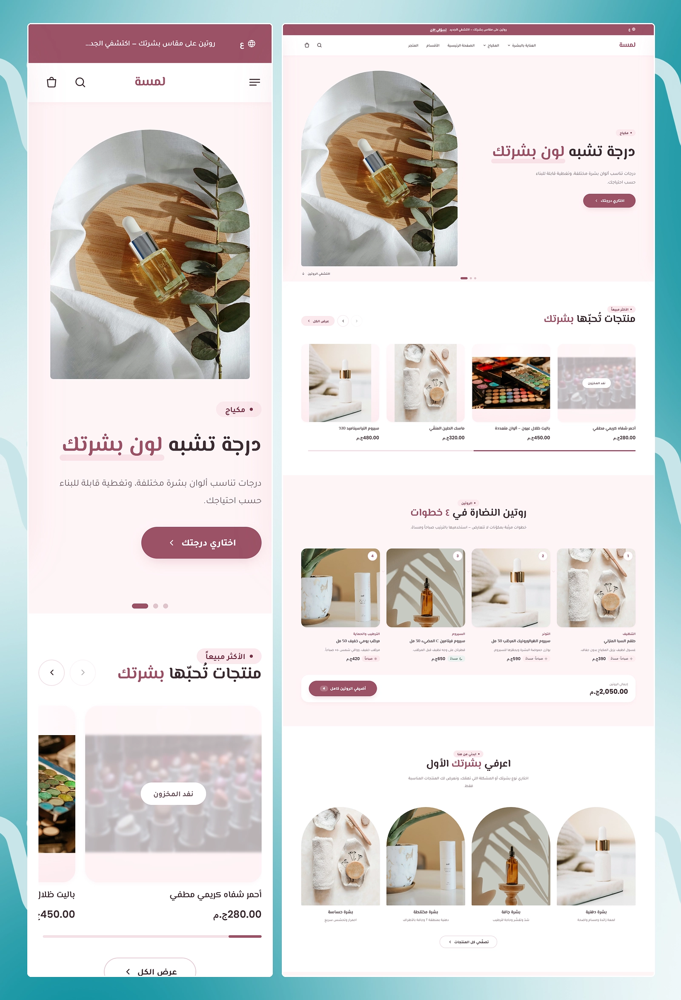

**HADIYA**

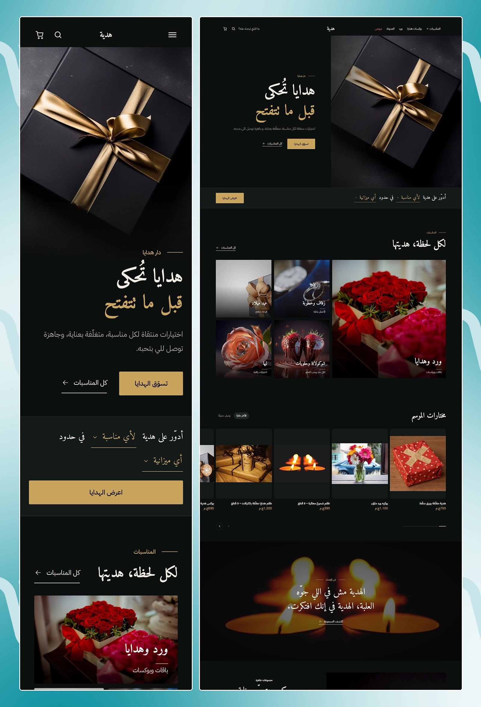

**ATTAR**

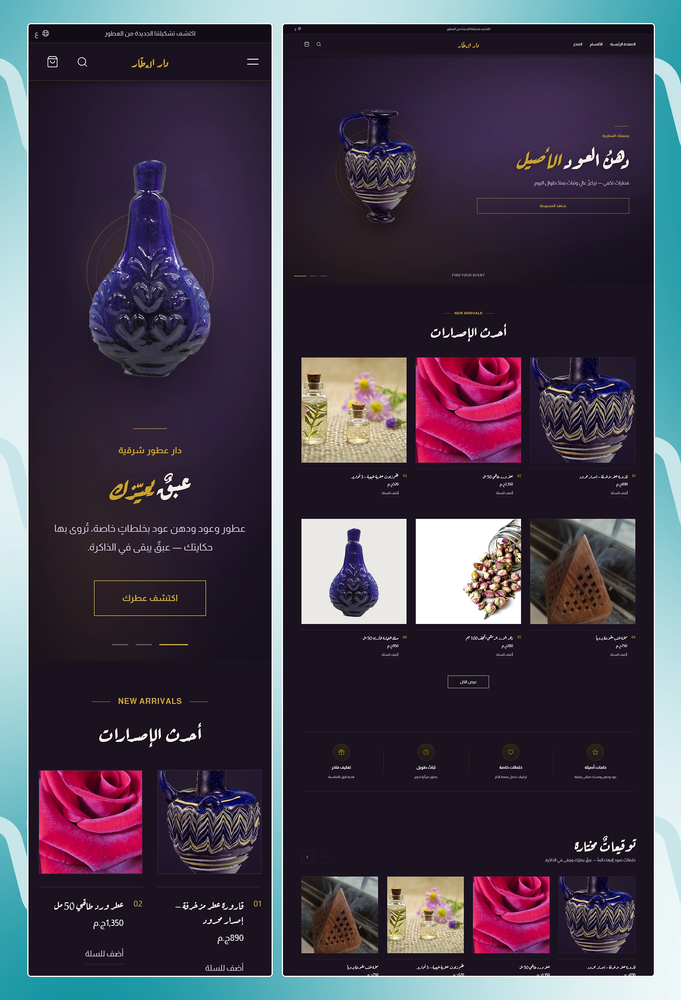

**MORVA**

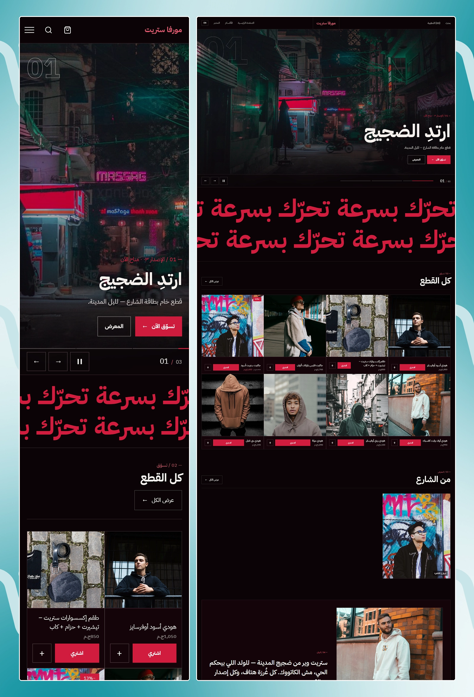

**MUHARRIK**

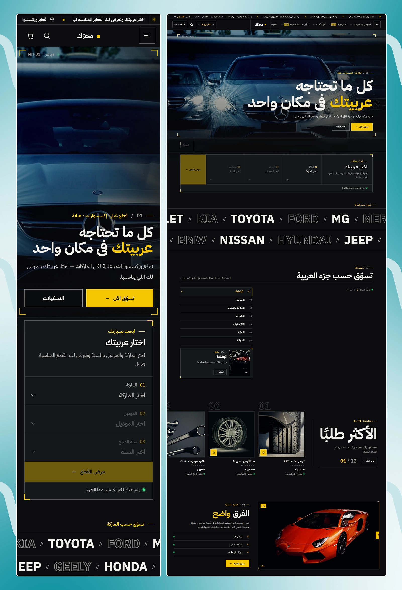

**baby-supplies**

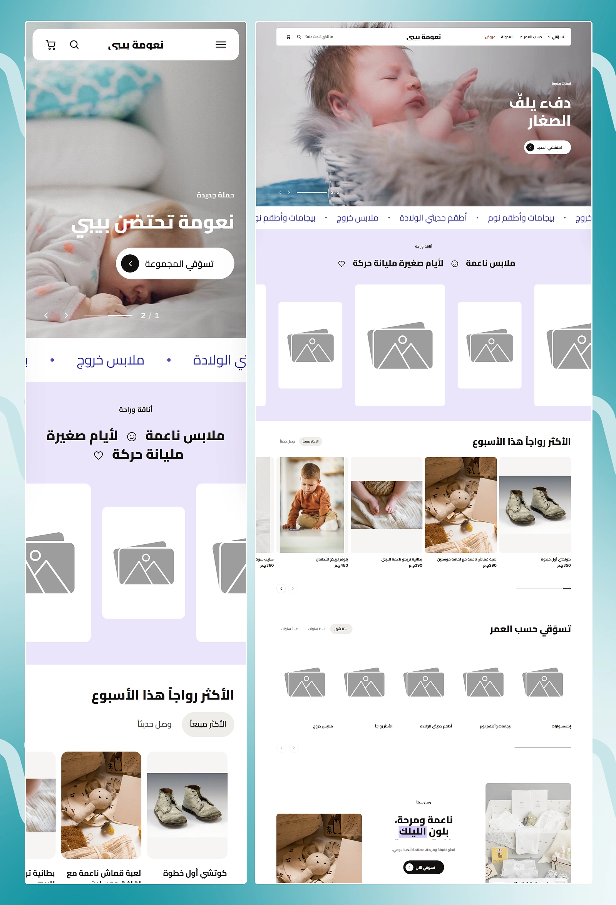

**coffee (DECAFE)**

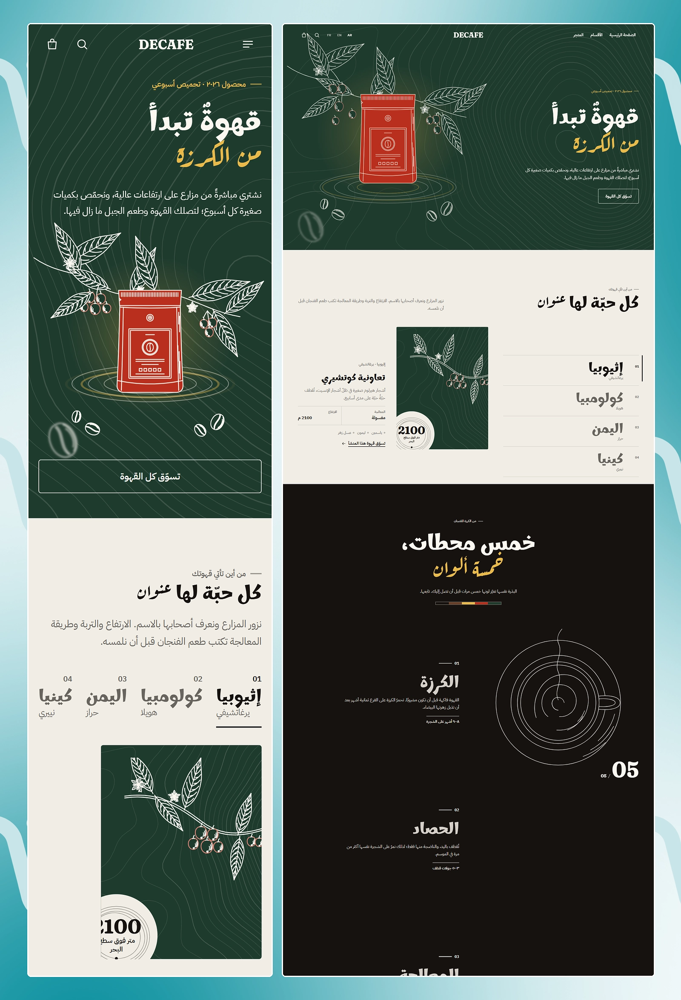

**Mish-Mavin**

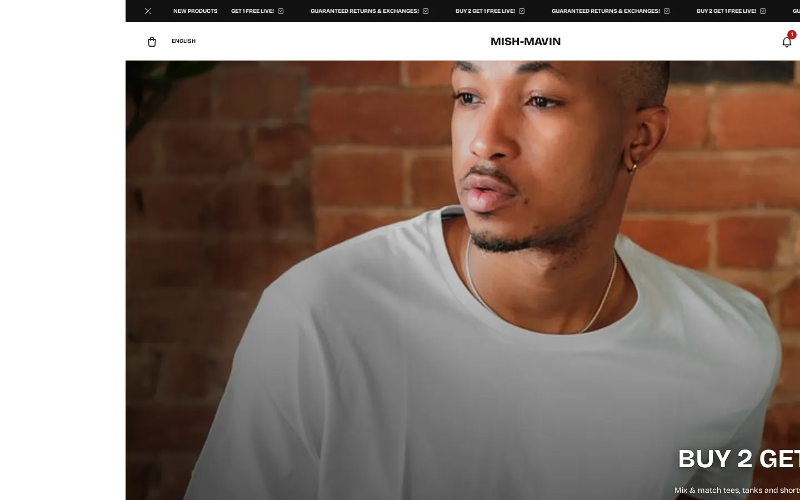
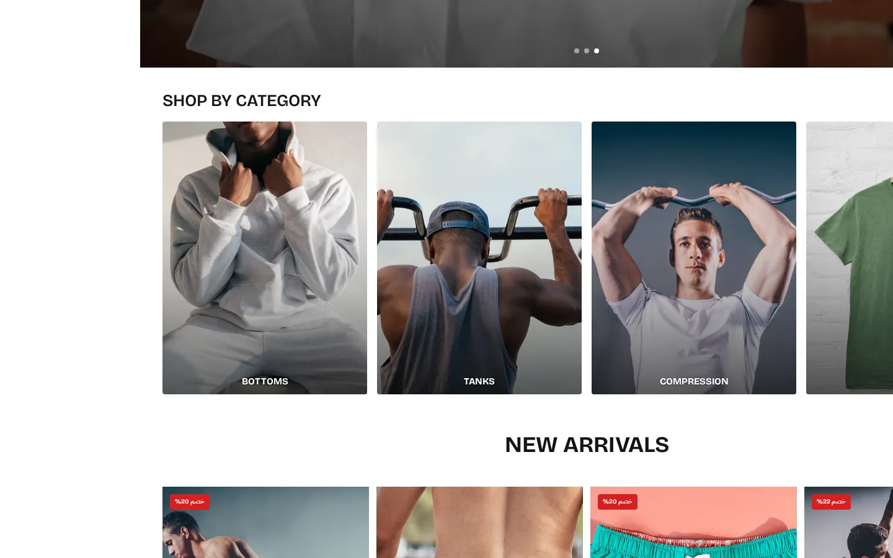

**Bulk** — sportswear store (Arabic RTL, dark theme)

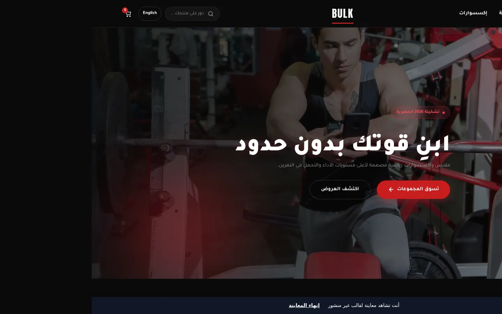
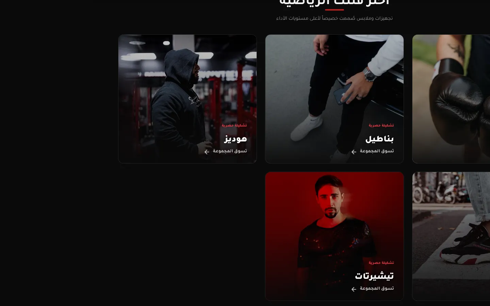
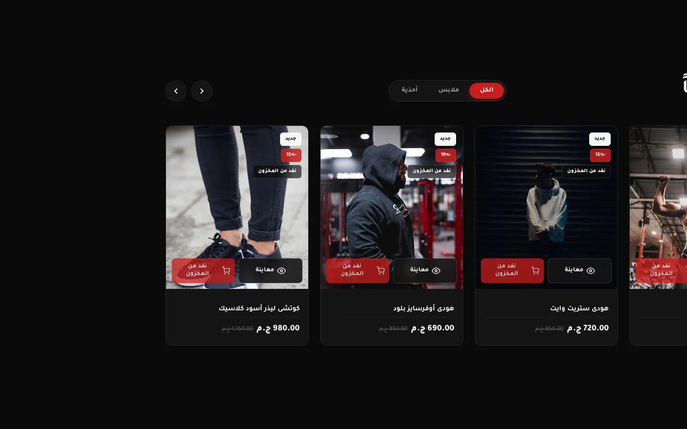

## Theme structure

Each theme follows the Qumra theme architecture:

```
theme/
├── layouts/     # Base page layouts
├── pages/       # Page templates (home, product, collection, cart, ...)
├── templates/   # Reusable page templates
├── widgets/     # Configurable sections merchants arrange in the editor
├── ui/          # Shared UI components (cards, buttons, forms, ...)
├── settings/    # Theme settings schema (colors, typography, layout)
├── locales/     # Translations (ar / en / fr)
└── assets/      # CSS, JavaScript, images
```

## Highlights

- **Bilingual & RTL-first** — every theme ships with Arabic and English locales (some also French) and right-to-left layouts.
- **Merchant-configurable** — sections, colors, fonts and content are editable from the store's theme editor through widget and settings schemas.
- **Responsive** — mobile-first layouts for product grids, navigation and cart.
- **Storefront features** — product pages with variants, collections, search, AJAX cart, blog and content pages.
- **Build tooling** — the `coffee` theme uses Tailwind CSS with an asset-stamping script for cache busting.

## Tech

Nunjucks (`.njk`) templates · CSS / Tailwind CSS · Vanilla JavaScript · JSON schemas · i18n (ar / en / fr)
